

  <a href="https://alexuswingz.github.io"></a>

  
  
  
  

Eight years of full-stack engineering, four of them leading five-engineer teams, and a habit of shipping the whole thing myself: product design, API, infrastructure, security, App Store review. Twice trusted to architect financing platforms from scratch. Twice led an engineering organization's move to AI-native development.

Most of my work lives in private repositories. Instead of reading about it, **[try the real app bundles in your browser](https://alexuswingz.github.io)**, or buy the one on the App Store.

 

## What I bring

<table>
  <tr>
    <td width="50%" valign="top">
      <h3>🚀 Full product ownership, proven publicly</h3>
      Cashn't is a <b>paid</b> budget-tracking app live on the Apple App Store, built entirely solo: product design, AI coach, backend API, privacy compliance and App Store review. Passed review on the first submission.
    </td>
    <td width="50%" valign="top">
      <h3>✨ AI transformation leader, not just a user</h3>
      Introduced MCP, Claude Code and Cursor to entire engineering orgs, wrote the adoption standards and trained the engineers. Teams hiring for AI-readiness get someone who has already led that transition twice.
    </td>
  </tr>
  <tr>
    <td width="50%" valign="top">
      <h3>🏗️ Builds from zero, at production quality</h3>
      Twice trusted to architect financing platforms from scratch. Systems handling real money, delivered with high-availability AWS infrastructure, observability and automated pipelines.
    </td>
    <td width="50%" valign="top">
      <h3>🤝 Multiplies teams</h3>
      Led and mentored 5-engineer teams at three consecutive companies, running disciplined Agile delivery while raising the bar through code review, documentation culture and hands-on coaching.
    </td>
  </tr>
</table>

 

## Featured work

Eight products, every one designed, built, deployed and operated by me alone. The portfolio runs the real builds in your browser.

 

### 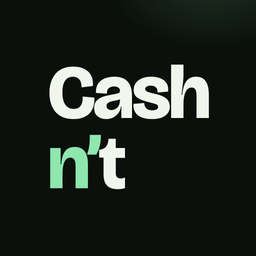 &nbsp;Cashn't &nbsp;·&nbsp; Paid iOS app, live on the App Store

> A budget tracker that gives you one honest number: **what is safe to spend today**. With an AI money coach built from your real numbers.

  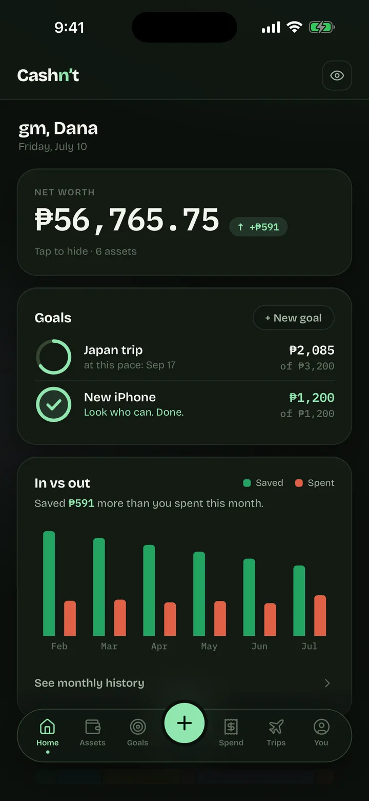&nbsp;
  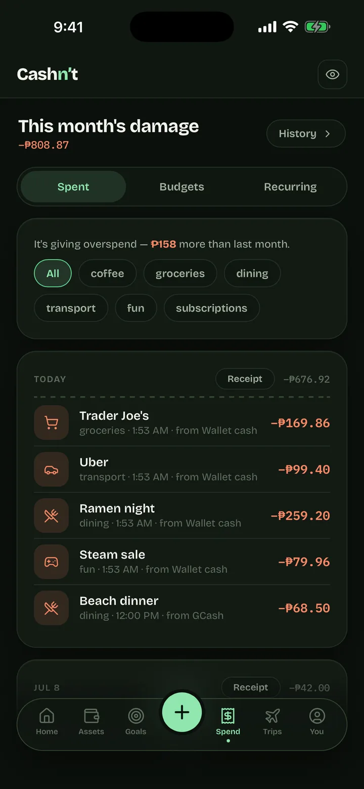&nbsp;
  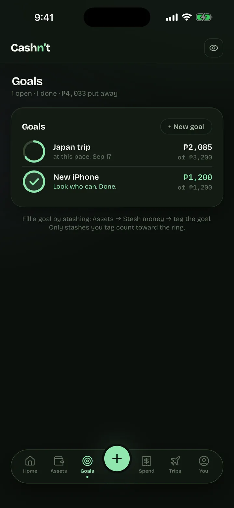&nbsp;
  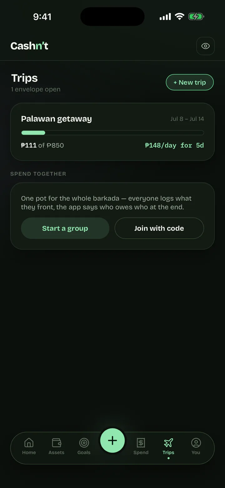

- **"Safe to spend today" engine** computes one daily number from balances, bills, paydays and savings goals.
- **AI money coach**: ask "can I afford this?" in plain language and get a plan generated from your actual financial data. Production LLM integration, not a demo.
- Net worth across cash, banks, e-wallets, investments and crypto; recurring bills and payday detection; envelope-style trip budgets; group pots with automatic who-owes-who settlement.
- **Privacy as a feature**: local-first guest mode, Face ID lock, privacy masking, in-app account deletion. Custom sync API on Railway with Apple / Google / email sign-in.

`React 19` `TypeScript` `Vite` `Capacitor 8` `Firebase Auth` `Express` `PostgreSQL` `Railway` `Recharts` `PWA` `Xcode / App Store Connect`

**[▶ Try the live demo](https://alexuswingz.github.io/#projects)** &nbsp;·&nbsp; **[View on the App Store](https://apps.apple.com/app/id6789244062)**

 

###  &nbsp;LOCA &nbsp;·&nbsp; Hyperlocal social app · Web + iOS · Live on Railway

> Your stuff. Your people. Nearby. Neighbors give things away, ask for things, borrow things and offer help.

  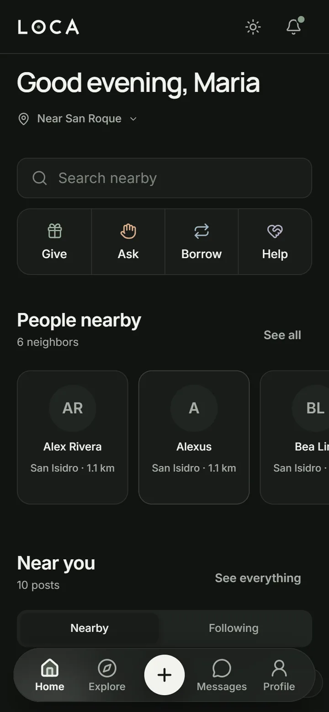&nbsp;
  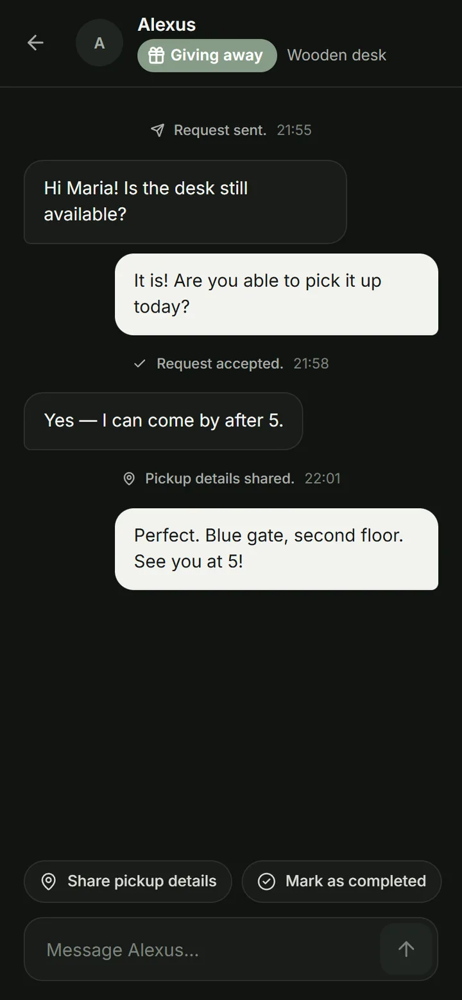&nbsp;
  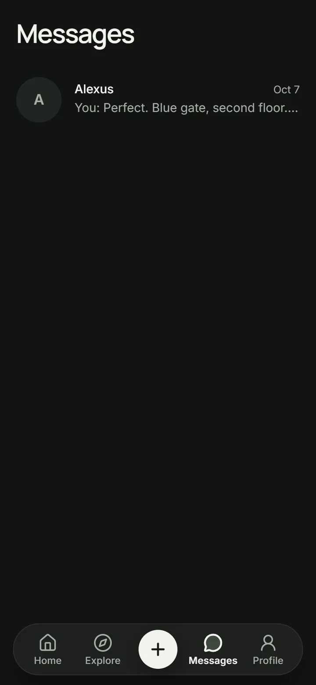&nbsp;
  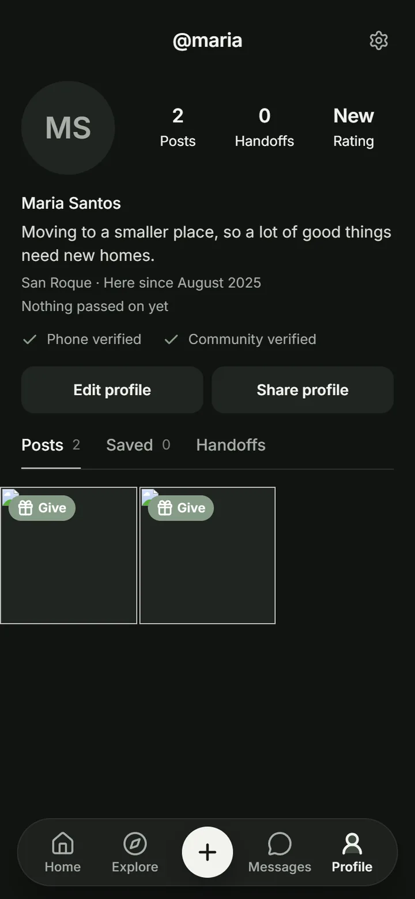

- **pnpm monorepo**: React web app, NestJS + Prisma API, shared packages. 34-table schema, 18 migrations, 17 end-to-end test suites.
- **Auth end to end**: email verification and reset, Google and Apple via Firebase, cookie sessions for web and token sessions for native, rate-limited and CSRF-checked by origin.
- Real domain logic: give / ask / borrow / help posts, offers and acceptance, two-sided borrow handoff and returns, messaging with unread state, saved searches and a rules-based matching engine.
- **Live feed over server-sent events**, APNs push on local time slots, message moderation in English and Tagalog plus OpenAI moderation. CSP, HSTS, per-client rate limits, media retention sweeps.
- Deployed on Railway: Caddy serves the web app and proxies `/api` to a private API over the internal network. Postgres and object storage never get a public address.

`React` `Vite` `NestJS` `Prisma` `PostgreSQL 18` `Capacitor (iOS)` `Firebase` `APNs` `S3` `Apple Maps` `OpenAI` `Resend` `Caddy` `Railway`

**[↗ Open the live app](https://web-production-202cdf.up.railway.app/)**

 

###  &nbsp;Studyverse &nbsp;·&nbsp; Student productivity &amp; social learning · Mobile-first

> Schedules, reviewers, flashcards and a class community for Filipino students, with AI that turns photos into timetables and notes into reviewers.

  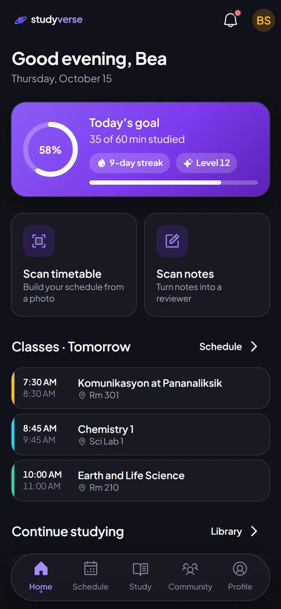&nbsp;
  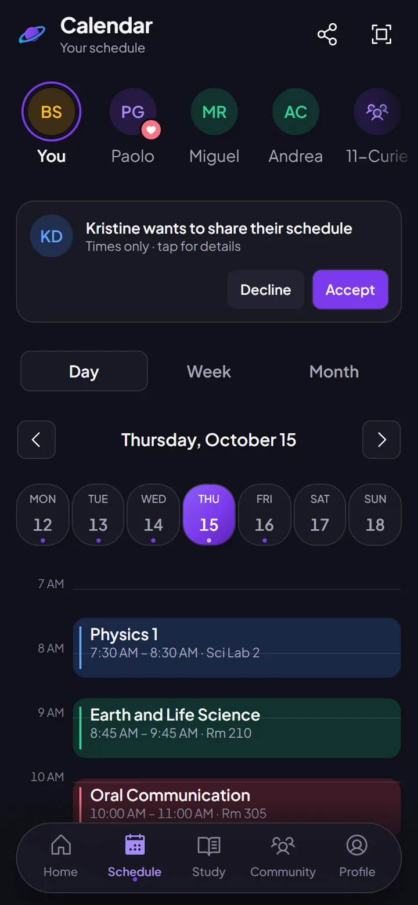&nbsp;
  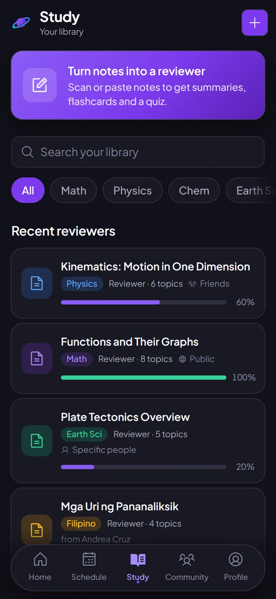&nbsp;
  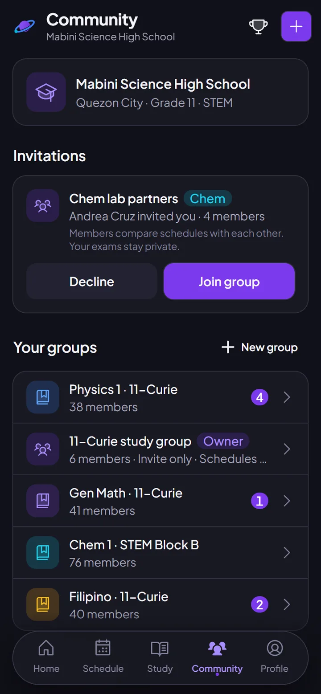

- **Brand identity and design system from scratch**: a scripted SVG pipeline renders every logo, icon and favicon from geometry, with light and dark themes and WCAG AA contrast on every token pair.
- **AI in production**: photograph a timetable and it becomes your schedule; photograph notes and get a saved reviewer with a flashcard deck.
- Data layer built for a native feel: stale-while-revalidate cache, prefetched tab roots so no screen shows a skeleton, WebSocket client with reconnect, backoff and heartbeat.
- Runs fully on in-memory mocks without a server, and against the real API with a single env variable.

`React 19` `TypeScript (strict)` `Vite 8` `Tailwind CSS 4` `React Router 7` `Zustand` `Motion` `Capacitor 8` `Node` `PostgreSQL` `WebSockets` `OpenAI` `Railway`

**[▶ Try the live demo](https://alexuswingz.github.io/#projects)**

 

### 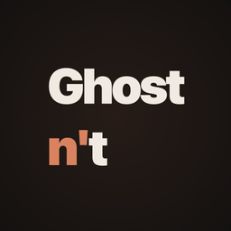 &nbsp;Ghostn't &nbsp;·&nbsp; Dating app · iOS · API live on Railway

> The dating app where ghosting is impossible. One hour a night, answers before faces, then you both choose: **hold or cut**.

  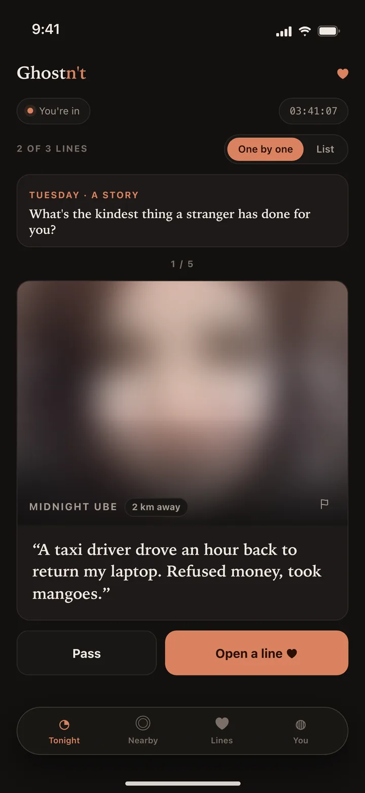&nbsp;
  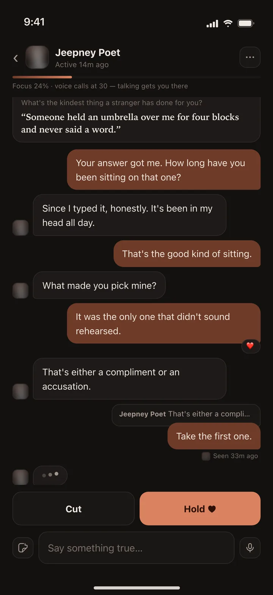&nbsp;
  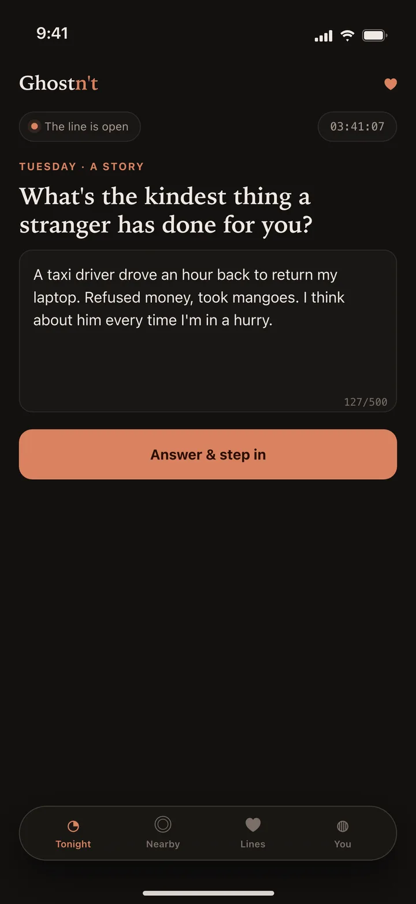&nbsp;
  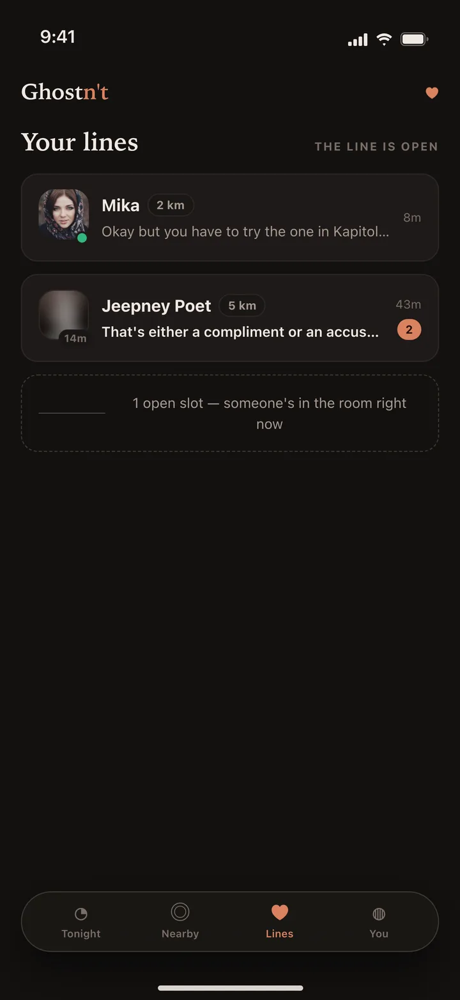

- **A product with real rules**: the room opens for one hour a night, one answered question is your ticket in, you pick people by their answers, and held lines climb a reveal ladder: voices, first names, then faces. Miss two nights and the line flatlines.
- **Live chat over WebSockets** with heartbeat reaping, server-authoritative countdowns with clock skew measured on every API call, and in-app calls with native CallKit integration.
- **Backend built for cost and speed**: one pg pool with statement timeouts, every endpoint a single round-trip (CTEs, lateral joins, no N+1), keyset pagination, partial indexes, advisory locks to serialize competing line-opens.
- Route-level code splitting (1–5 KB per screen), sockets only while a line is alive, reduced-motion support. Shipped through the same headless App Store pipeline as Cashn't.

`React 19` `TypeScript` `Vite` `Capacitor 8` `Express 5` `PostgreSQL` `WebSockets` `Firebase Auth` `CallKit (Swift)` `Railway` `App Store Connect`

**[See it in the portfolio](https://alexuswingz.github.io/#projects)** &nbsp;·&nbsp; iOS build in App Store review

 

###  &nbsp;Cinemi &nbsp;·&nbsp; AI photo studio · Design system + product

> A mobile-first AI image studio driven by photography slash-commands. Type `/85mm` or `/filmgrain`, compare before and after, retouch faces on-device.

  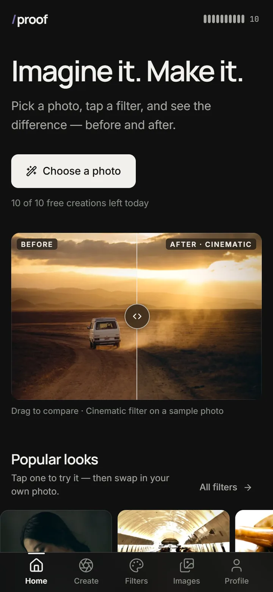&nbsp;
  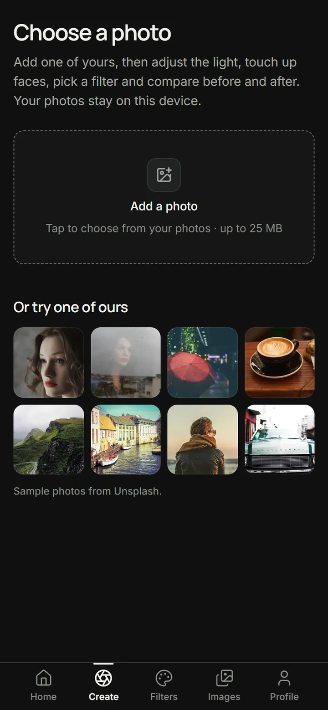&nbsp;
  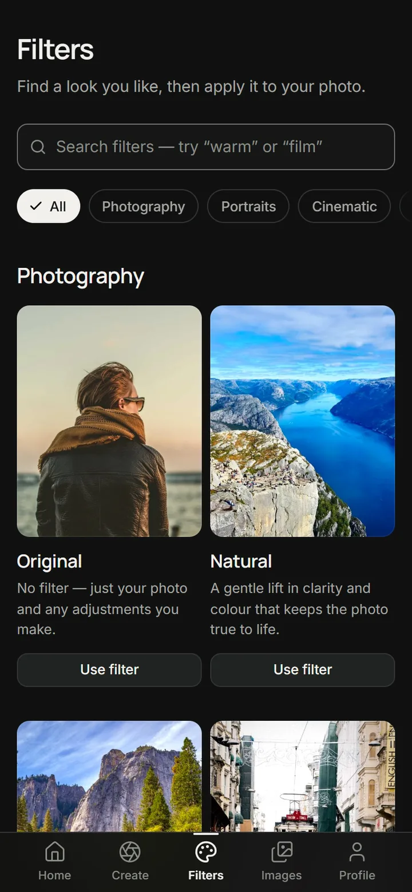&nbsp;
  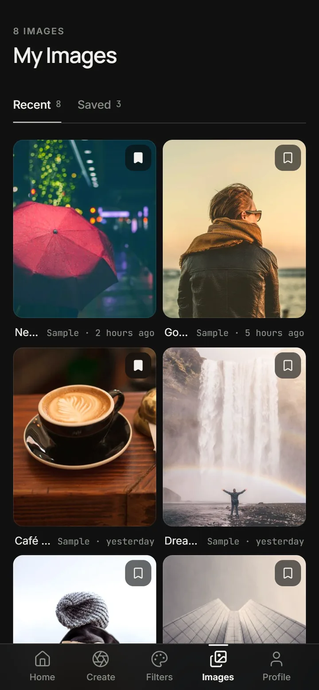

- **"Editorial After Dark" design system**: 60+ components, semantic tokens, dark and light themes, motion and safe-area tokens. The reference page reads token values live from the CSS, so docs cannot drift from code.
- **On-device face retouching** with MediaPipe's face landmarker in WebAssembly. Photos never leave the phone.
- Slash-command prompt composer with searchable catalogue, prompt preview and compile step; before/after compare slider; monetization components designed in from day one.

`React 19` `TypeScript 6` `Vite 8` `Tailwind CSS 4` `Radix UI` `CVA` `MediaPipe (WASM)` `shadcn/ui` `Capacitor-ready`

**[▶ Try the live demo](https://alexuswingz.github.io/#projects)** &nbsp;·&nbsp; **[Design-system reference](https://alexuswingz.github.io/demos/proof/)**

 

###  &nbsp;Job Finder &nbsp;·&nbsp; CV-matched job feed · FastAPI + React

> One feed that aggregates LinkedIn, Indeed, JobStreet and Google Jobs, scores every listing against your CV and explains why it matched.

  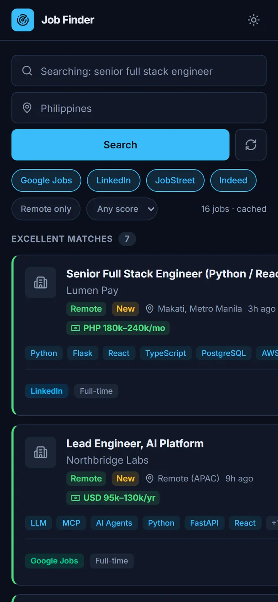&nbsp;
  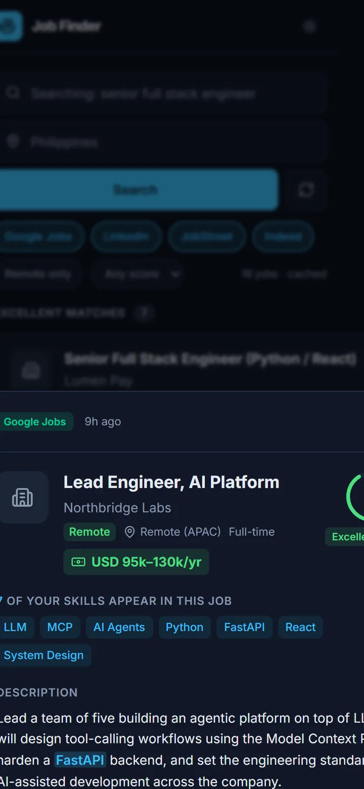&nbsp;
  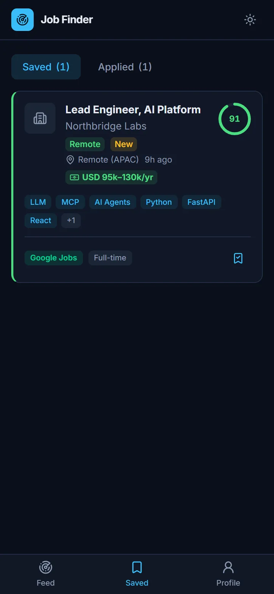&nbsp;
  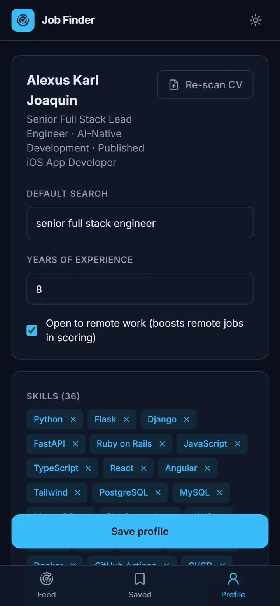

- **Scoring engine** gives every job a 0–100 match: skill overlap, title relevance, recency, location and remote fit, with a seniority adjustment. Matched skills shown on every card.
- Concurrent fan-out to four job boards with free direct scrapers first and RapidAPI fallbacks only when a direct fetch returns nothing. Deduplication across sources and a 6-hour cache.
- Upload a `.docx` CV and the matching profile is re-extracted automatically. Same codebase runs as web and Capacitor mobile app.

`Python` `FastAPI` `httpx` `SQLite / PostgreSQL` `React` `TypeScript` `Tailwind CSS 4` `TanStack Query` `Railway`

**[↗ Open the app](https://alexuswingz.github.io/demos/jobfinder/feed)**

 

### 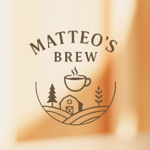 &nbsp;Matteo's Brew &nbsp;·&nbsp; Coffee shop website + digital menu · Client work

> A warm, motion-rich website for a neighbourhood coffee shop, with a searchable digital menu customers open from a QR code at the counter.

  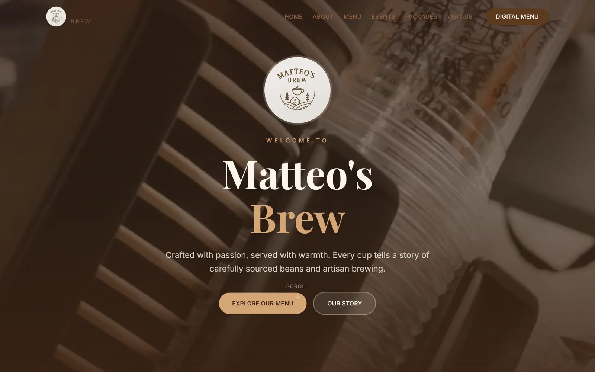&nbsp;
  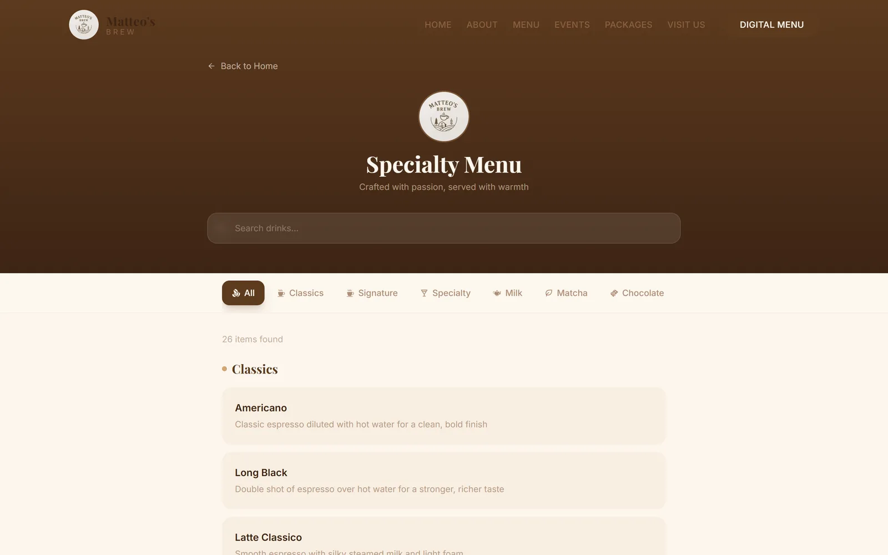&nbsp;
  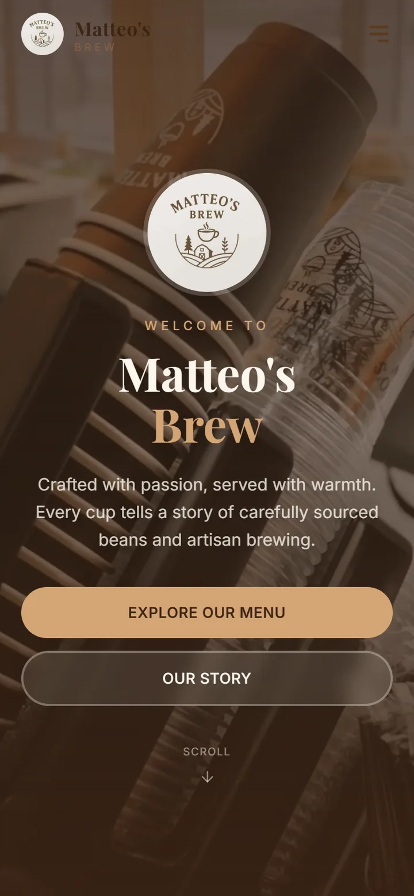

- Full-bleed video hero and animated sections for the story, menu preview, events, packages and location, all tuned for phones first.
- **Digital menu**: 26 drinks across six categories with instant search and category filters, plus a QR-code section that drops customers straight into the menu from the table.
- Ships as a static build, so hosting costs nothing and it loads instantly.

`React 19` `Vite 7` `Tailwind CSS 4` `Framer Motion` `React Router 7` `QR codes` `Static hosting`

**[↗ Open the live site](https://alexuswingz.github.io/demos/matteosbrew/)** &nbsp;·&nbsp; **[Source](https://github.com/alexuswingz/MatteosBrew)**

 

###  &nbsp;Alexus Legal AI &nbsp;·&nbsp; AI legal assistant · Philippine law · Next.js

> A conversational AI legal companion for Filipinos: explains Philippine law in plain language, relates it to your situation and ends with concrete next steps.

  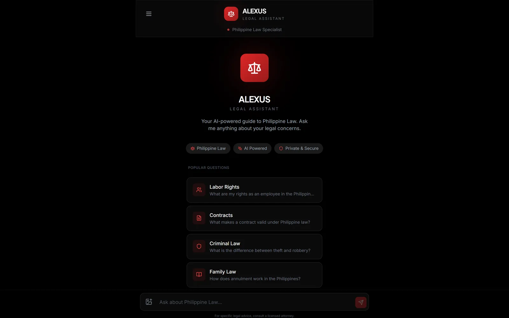&nbsp;
  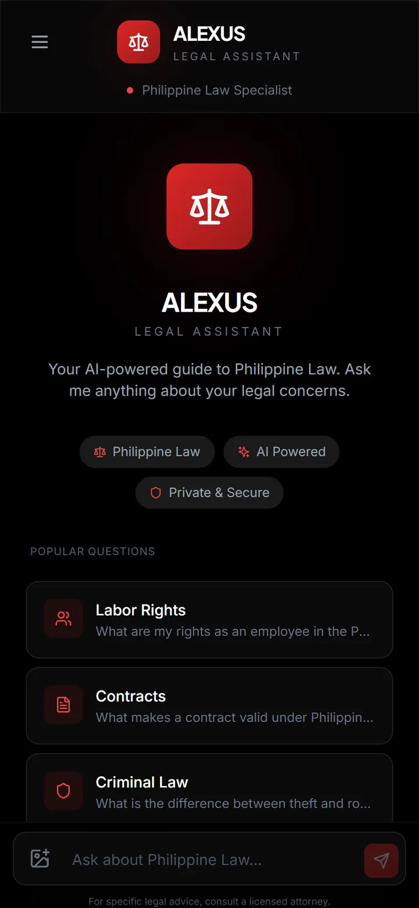&nbsp;
  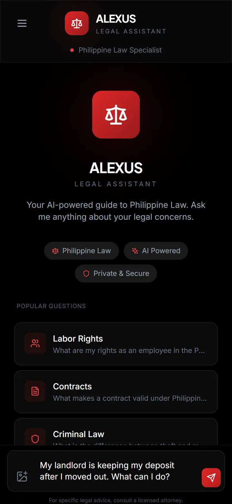

- **Streaming chat** on the Next.js App Router with a system prompt engineered for empathy: acknowledge the situation, tie answers to the specific case, explain statutes simply, always finish with actionable steps.
- Covers the Constitution, Civil Code, Revised Penal Code, Labor Code, Family Code, property, tax, corporate and procedural law, with a clear "not legal advice" boundary.
- Per-user conversation history in PostgreSQL with an auto-initialised schema, image upload for document analysis, and a PWA manifest so it installs like a native app.

`Next.js 14` `TypeScript` `Tailwind CSS` `OpenAI` `PostgreSQL` `PWA` `Railway`

**[See it in the portfolio](https://alexuswingz.github.io/#projects)** &nbsp;·&nbsp; **[Source](https://github.com/alexuswingz/LawSystem)**

 

###  &nbsp;1000 Bananas Platform &nbsp;·&nbsp; Company project · The Jungle Group / TPS Nutrients · Built solo

> The operations platform behind a multi-account Amazon business: demand forecasting, inventory and shipments, and a keyword "battlefield" command centre with an automated bid engine.

<table>
  <tr>
    <td align="center"><b>252 + 230</b> API routes</td>
    <td align="center"><b>44 + 72</b> pages</td>
    <td align="center"><b>~97</b> tables</td>
    <td align="center"><b>450</b> typed API client methods</td>
    <td align="center"><b>1</b> MCP server for AI assistants</td>
  </tr>
</table>

- **N-GOOS**: Next.js 14 + Django REST platform for forecasting, inventory, shipments and new-product development. JWT auth and tenant-scoped realtime over Django Channels.
- **Battlefield Command**: FastAPI + Next.js 16 command centre for search-term domination. A bid engine with editable strategy parameters, inventory-aware ad throttling, placement policy and cron services.
- **Amazon integrations**: SP-API catalog sync (fixed a silent gap that dropped ~346 merchant-fulfilled listings), Ads API reporting, multi-seller-account isolation.
- An **MCP server** that exposes platform capabilities to AI assistants, plus an Anthropic-powered tool builder with schema introspection and a hardened read-only SQL runner.

`Next.js 14 / 16` `React` `TypeScript` `Django 5 + DRF` `FastAPI` `PostgreSQL` `Django Channels` `Amazon SP-API` `Amazon Ads API` `MCP` `Sentry` `Railway`

Proprietary, so no public demo. Happy to walk through the live system on a call.

 

## Stack

  
  
  
  
  
  
  
  
  
  
   
  
  
  
  
  
  
  
  
  
   
  
  
  
  
  

| | |
|---|---|
| **Backend** | Python (Flask, Django, FastAPI), Ruby on Rails, Node (NestJS, Express), REST API design |
| **Frontend** | React, Next.js, TypeScript, Tailwind CSS, design systems, Angular |
| **Mobile** | iOS via Capacitor, App Store publishing and review, release management |
| **Data** | PostgreSQL, MySQL, MongoDB, Elasticsearch, Prisma |
| **Cloud & DevOps** | AWS (EC2, S3, RDS, CloudFront, ELB), Docker, GitHub Actions, Railway, Caddy |
| **AI** | LLM integration in production, Model Context Protocol servers, AI agents, Claude Code and Cursor adoption programs |
| **Observability** | Grafana, Sentry, alert-first incident handling |
| **Leadership** | Agile / Scrum, mentoring, code review culture, technical documentation (Notion) |

 

## Experience

| | Company | Role | Highlights |
|---|---|---|---|
| **2025 → now** | **Cloud Employee** | Senior Full Stack Engineer | Rails + React + PostgreSQL production apps. Pioneered the company's shift to AI-native engineering: MCP integrations, company-wide Claude Code and Cursor rollout, authored the AI-assisted development standards. Designed the Grafana + Sentry observability stack. |
| **2024 → 2025** | **Capital Source Group** | Senior Full Stack Lead Engineer | Designed, built and launched the core Financing System from scratch. Architected the AWS production environment (RDS, Elasticsearch, load balancers). Owned CI/CD end to end. Led a team of 5. |
| **2021 → 2024** | **Vertere Global Solutions** | Senior Full Stack Lead Engineer | Spearheaded financing systems through multiple major iterations. Full AWS stack, Selenium data pipelines, GitHub Actions CI/CD. Led and mentored a 5-member team. |
| **2018 → 2021** | **FurtherEdge Co.** | Software Engineer | Recruited on the strength of freelance work delivered as a second-year student. Angular + Python client apps, REST APIs, AWS hosting. Graduated BS Information Technology, Magna Cum Laude, while working. |

 

## Let's talk

Open to senior and lead full-stack roles, remote-first. Based in the Philippines.

  
  
  

Most repositories here are private because they are commercial products or client work. The portfolio runs the real builds in your browser; source walkthroughs are available on request.
